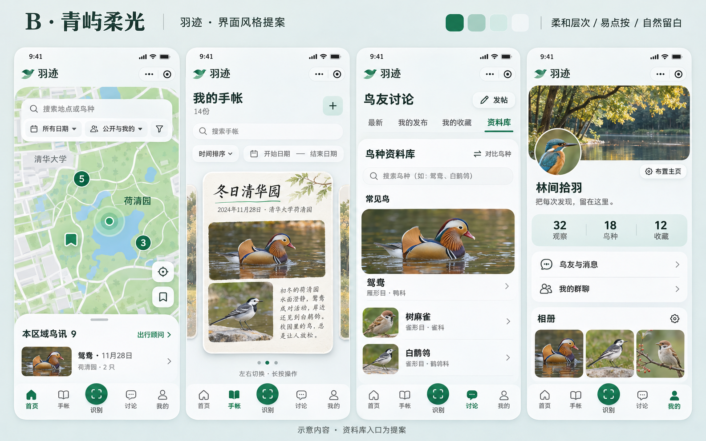
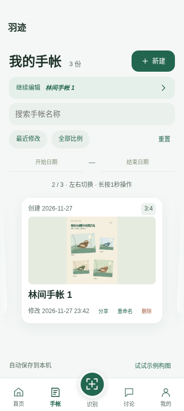

# B视觉对齐：尚未完成

2026年11月29日（北京时间）。**首轮0.4.23尚未实现B的整体构图。** 已有工程修复与基础配色／字体清理，但不能据此认定视觉改版完成。R124重新明确为未完成状态。

B“青屿柔光”是浅色参考：绿色主色、白色内容面、克制的冷绿层次。E仅为后续深色方向。当前应对齐B的层级和比例，无需再生成一组相似配色。

| 页面 | B参考 | 首轮实现的差距 | 应完成的调整 |
| --- | --- | --- | --- |
| 地图 | 地图上的悬浮搜索／筛选；底部紧凑的真实记录预览 | 仍是独立通栏工具栏、大数字卡与单独出行条 | 重组浮层与记录预览，保留所有筛选、地图操作及波纹 |
| 手帐 | 纸张本身占主导，侧边纸张暗示卡组 | 管理卡内只放较小纸张缩略图，再叠标题和操作 | 让作品纸张成为主体，将管理信息移至卡组周围，保留上下划与分享／删除 |
| 讨论／资料库 | 清楚的页标题、下划线页签、主鸟种与较小辅助条目 | 仍大量沿用均匀卡片／网格与胶囊控件 | 对齐主次层级与页签，保留搜索、书签和讨论入口 |
| 我的 | 封面／头像交叠、统计横带、消息分组与紧凑相册 | 大身份卡、代表作和快捷胶囊将统计／相册推得过低 | 重排分组，同时保留队友的自定义封面、作品与可编辑快捷入口 |
| 文字 | 深色标题、明确字重、中性辅助文字，绿色只强调关键项 | 多处仍保留旧绿色文字层级及零碎小字 | 同时校对中文、英文鸟友号和数字，使用一致字号及设备系统字体 |

当前手帐投影可直接看出构图差距：

参考图是示意提案，当前图来自实际WXML／WXSS投影，均不是真机验收截图。后续对照应采用内容相近且来源／许可明确的鸟类照片，避免示例插画掩盖布局差别。

测试与几何检查只证明其覆盖的功能和尺寸约束，不证明接近B或审美通过。应先逐页对照，再验原生字体、边距、键盘及安全区。保留地图波纹、手帐卡组／发光和面板关闭交互；普通界面采用无衬线字体，手帐作品及上划入云可保持独立风格。

