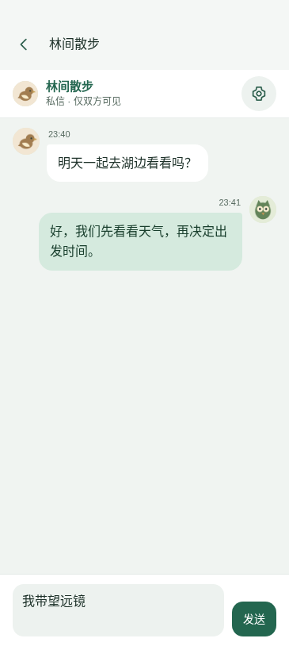
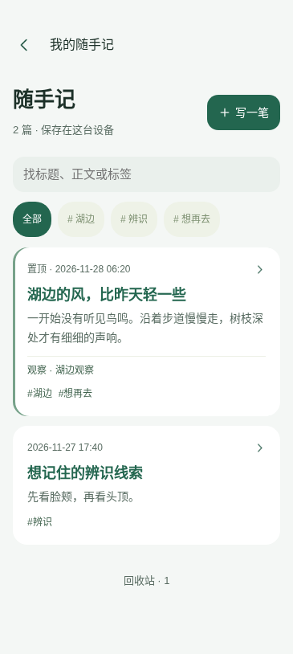
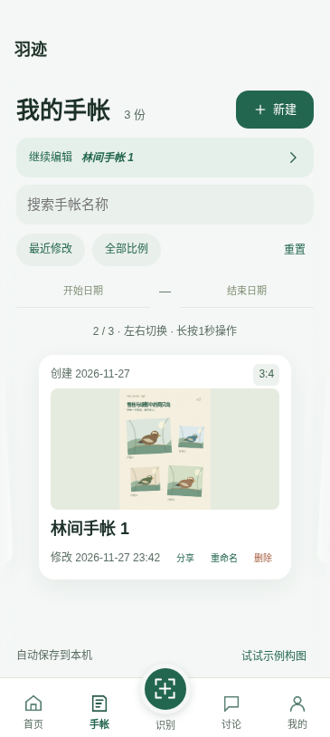
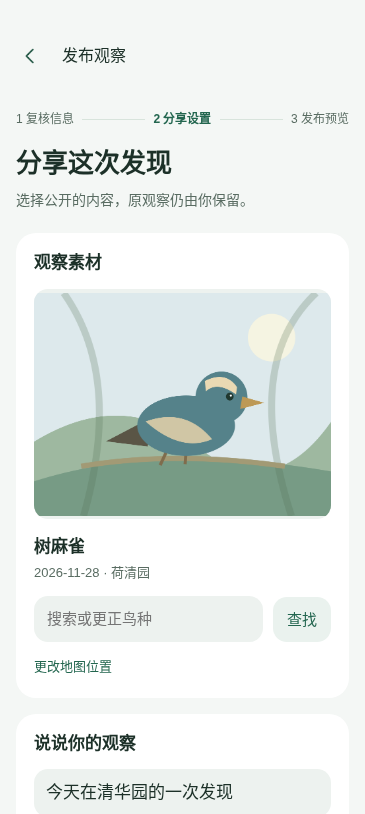
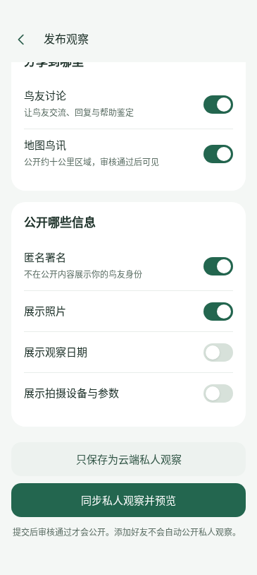
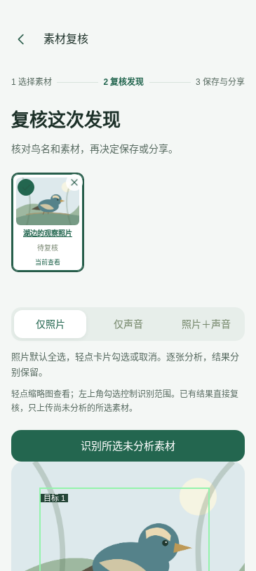

# 0.4.23 — 绿色与白色视觉改版候选

**状态修正：** 本轮仅为首轮工程与基础视觉清理，B整体构图尚未对齐。[原始参考与当前差距](VISUAL-ALIGNMENT-B.md)。自动检查不等于视觉验收通过。

2026年11月29日（北京时间）。分支 `feat/visual-system-0.4.23` 基于团队主分支 `ed907d93e5096ab8774d0f3289ef10ecf4d24818`，包含已合并的 PR #31，并保留队友新增的个人主页、相册封面和管理后台。用户手机中的0.4.20仍是旧体验版。

## 视觉方向

以B为浅色默认方向：绿色强调操作与选中态，白色承载内容，页面使用中性浅灰绿。E只作为后续深色模式参考，本轮未实现深色模式。界面标题、英文、数字与中文统一采用系统无衬线字体；传统元素仅保留在手帐分享的动效语境中，不再铺满普通页面。

| 角色 | 规则 |
| --- | --- |
| 主要操作 / 正文 | `#23664f` / `#1c3028` |
| 辅助文字 | `#596c62` |
| 页面 / 内容卡片 | `#f4f7f5` / `#ffffff` |
| 字体 | Apple系统 / 苹方 / HarmonyOS / 微软雅黑，按设备回退 |
| 页面标题 / 正文 | 26px半粗 / 15–16px；辅助信息12–14px |
| 手机内容左右边距 | 16px；相邻控件使用明确间距 |
| 卡片 / 按钮圆角 | 20px / 14px；圆形控件固定等宽等高 |

共享样式位于 `miniprogram/styles/visual-system.wxss`。减少反复出现的浅色描边框，采用白色内容分组和清晰文字层级。手帐作品内原有字体选择不受影响。

## 本轮实现

- 私信与群聊使用独立的消息滚动区，输入栏固定在可用窗口底部。键盘遮挡和窗口缩小两种情况分别计算，避免扣两次键盘高度。消息采用左右气泡、头像和时间；长按复制或举报。查看旧消息时新消息不强行跳到底部，改为提示；分页保持原消息位置。本轮仍是页面可见时每5秒轮询，没有新增推送服务。
- 鸟友、会话设置和转发页面重新整理间距与行式结构；讨论页第四项直接进入资料库。
- 识别复核、相册导入和发布页改为更清楚的步骤与内容分组。发布页区分观察素材、说明、发布去向和公开信息，保留原有复核、私人保存、预览确认和审核流程。
- 帖子点赞／回复／书签的图标与文字整体居中，两个分享按钮明确分隔；回复框内边距、宽度与标签对齐。随手记、手帐列表、个人页、日期与选择面板及其他子页同步基础视觉。
- 保留地图波纹、手帐滑动／发光与弹窗拖动关闭。此次以浅色界面为主，未重做这些交互。

## 好友地图记录的问题

队友截图中的蓝绿色数字聚合点对应私人观察；这不等同于已经公开的地图鸟讯。双方地图范围和缩放级别也不同，9与24不能直接比较。添加好友不应公开私人坐标。

地图新增“公开鸟讯／仅自己”图例；鸟友主页新增“地图鸟讯”页签，显示最近50条署名且审核通过的公开地图记录，并复用现有详情／地图跳转。匿名、待审核和撤回记录不展示，屏蔽关系仍生效，公开地点继续使用原有粗粒度位置处理。旧服务不支持 `mapRecords` 时显示明确说明。

**需要服务维护者部署随附 `backend/src/bird_business/social.py` 改动，新的按作者列表才会生效。此提交没有代部署。** 联调时请使用同一AppID和服务、同一范围／日期，分别验证署名公开、匿名、待审核、撤回和屏蔽，避免把私人观察误当成公开记录。

## 服务现状

本轮只进行了只读检查：社区 `/api/v1/community/capabilities` 返回200；视觉 `/api/v1/vision/readyz` 返回200且检测器、BioCLIP及推理运行时就绪；写作 `/api/v1/journal/capabilities` 仍返回404，因此不能确认Qwen写作已恢复。懂鸟回退逻辑已存在于当前源码，但未发起真实鉴权图片识别、断GPU实验或付费调用。没有部署业务服务或启用CloudBase。

## 验证与图片

客户端501项测试、严格类型／源码检查及28 WXML／31 WXSS编译通过。后端28项社区测试与本轮Ruff检查通过，包括好友关系不泄露私人位置的新增回归。CloudBase仅执行现有离线检查和依赖审计。18种页面状态×38种窗口，共684个浏览器源码布局案例，检查范围内没有横向溢出、聊天输入栏／历史重叠、关闭按钮或开关挤压、反应图文间距塌陷及分享按钮贴合。

图片由当前WXML／WXSS投影生成，使用样例插画，**不是微信真机截图**；原生地图、相机及字体度量未被模拟。完整英文说明与复现命令见 [English](en/VISUAL-SYSTEM-0.4.23.md)。

## 合并前真机验收

1. 开发者工具完整Compile；320／360宽手机和平板检查中文、英文鸟友号、数字、长标题、日期与操作按钮。
2. iPhone／华为检查空会话、长历史、长草稿、键盘显隐、旋转、读旧消息时来新消息、分页、返回和底部安全区。
3. 相机→拍摄→复核→保存→发布预览，以及相册、声音、融合识别；权限拒绝、服务失败及重试时原素材仍保留。检查大字号和最后一个按钮可达。
4. 部署作者列表后用两个账号验证地图公开边界；旧服务保持可理解的降级说明。
5. 手帐继续验上划分享／下划删除、无固定绿色焦点描边、雾层时机与编辑器末尾按钮。云纹美术可在主要层级确认后单独改。

本轮未上传体验版，也不把浏览器投影通过当作真机验收完成。
