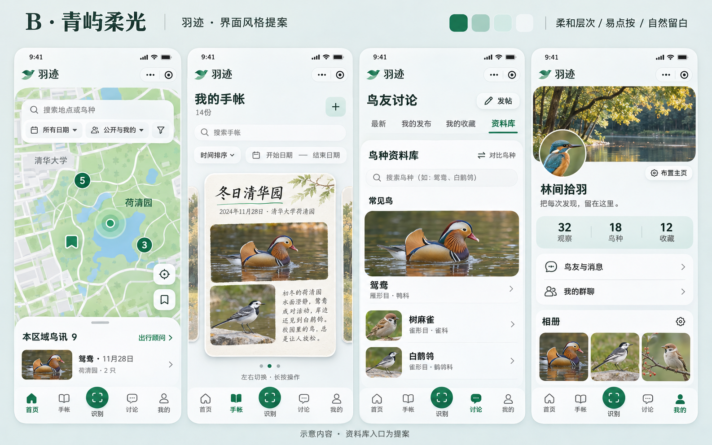
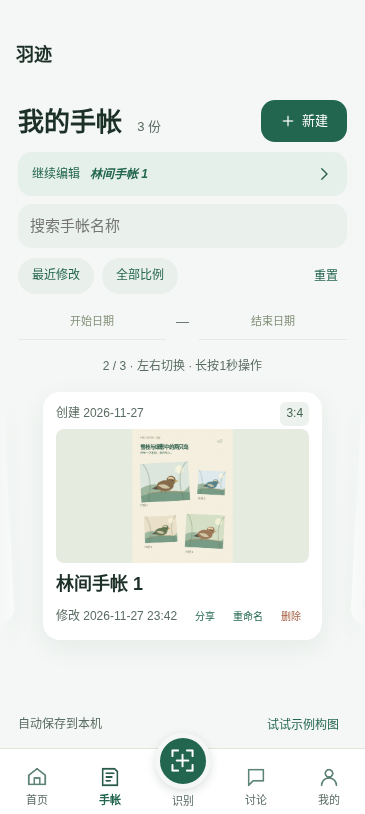

# B visual alignment — still open

29 November 2026 (Beijing). **The first 0.4.23 implementation does not yet reproduce B's composition.** It contains useful engineering changes and a colour/typography clean-up. Those are not sufficient grounds to mark the visual redesign complete. R124 remains open.

B, “青屿柔光”, is the light-mode reference. Green stays the primary colour, with white surfaces and restrained cool green layers. E is an optional later dark direction. The remaining task is to reproduce B's hierarchy and proportions, rather than generate another collection of similar colour variants.

## Reference and current gaps

| Area | B reference | Gap in the first implementation | Required correction |
| --- | --- | --- | --- |
| Map | Search/filter surface floats over the map; a compact bottom surface previews a real record | Separate full-width toolbar; large count tile and separate trip bar; little record content | Recompose the map overlays and bottom preview, while retaining every filter, map control and ripple |
| Journal | The actual paper is the main visual object; neighbouring pages imply the deck | A conventional white management card contains a small paper thumbnail, title and actions | Make the paper itself dominant; place management information around the deck and preserve swipe/share/delete |
| Discussion/library | Strong page heading, restrained underline tabs, one featured bird and smaller supporting rows | Uniform card/grid and pill structures retain much of the old hierarchy | Match the featured/detail hierarchy and tab treatment without losing search, library shelves or discussion routes |
| Profile | Distinct cover/avatar overlap, a statistics band, grouped message rows and a compact album | A large identity card, featured-work block and shortcut pills push statistics/albums far down | Reorder the profile sections and restore B's grouping, preserving the teammate's custom covers, works and editable shortcuts |
| Typography | Dark headings with clear weight; neutral supporting text; restrained green emphasis | The older green text hierarchy and scattered small captions remain in several modules | Compare Chinese, Latin handles and numbers together, with a consistent type scale and device-appropriate system fonts |

The current journal screenshot makes the composition gap especially clear:

The reference is a concept image with illustrative content. The current image is a projection of the actual WXML/WXSS. Neither is a native-device acceptance screenshot. Future comparison screens should use comparable real bird photos with known attribution, so placeholder illustrations do not obscure the layout differences.

## What the checks actually establish

The client/backend tests and source geometry checks remain valid for the assertions they exercised. They do not evaluate similarity to B, perceived hierarchy or visual quality. Do not use a passing test count to close R124. Check the core pages directly against the reference first, then verify native margins, text metrics, keyboard and safe areas.

Keep the map ripple, journal deck gestures/glow and sheet dismissal interactions. Keep normal interface text free of decorative traditional type. Journal artwork and the cloud-sharing treatment can remain distinct.

## Existing Windows checkout

Baguette's existing app checkout is `C:\Workspace\bird-assistant\bird-assistant-miniprogram`. Its parent directory is not the package directory. The current English plan restores the previous checked PowerShell block, including `npm.cmd` and exit-code checks. Keep the helper terminal and local AppID/configuration intact.
