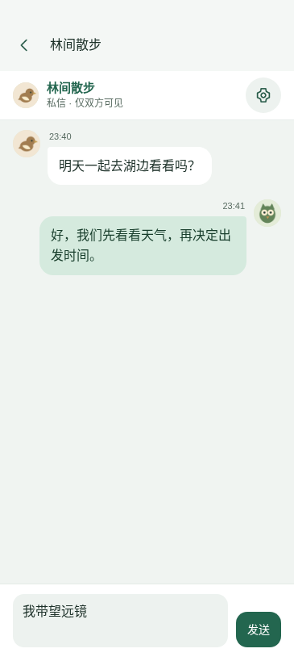
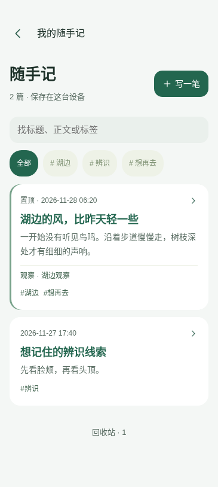
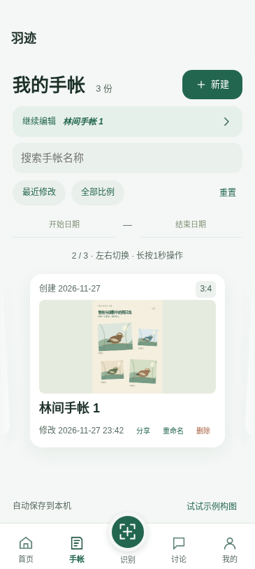
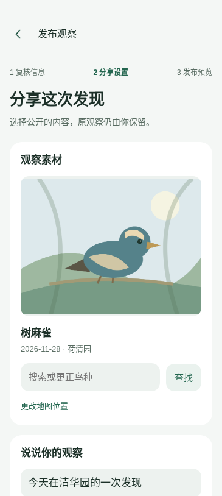
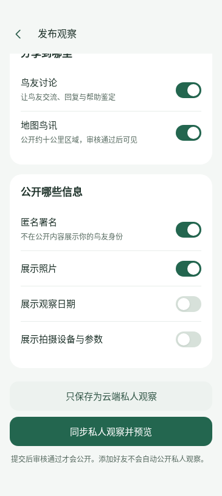
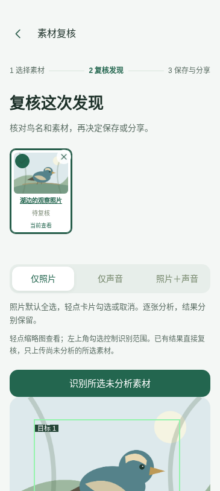

# 0.4.23 — green and white visual system

29 November 2026 (Beijing). Review candidate on `feat/visual-system-0.4.23`, based on team main `ed907d93e5096ab8774d0f3289ef10ecf4d24818`. That merge includes PR #31 and preserves the teammate's profile, custom album cover and admin work. The uploaded 0.4.20 experience build is a separate, older version.

## Direction and shared rules

B is the default light direction. E remains the optional dark-mode reference; dark mode is not implemented in this candidate. Use green for actions and selected state, white for content, neutral grey-green for the page. Reserve traditional illustration for journal sharing; interface titles use system sans-serif.

| Role | Value / rule |
| --- | --- |
| Primary action | `#23664f` |
| Main text | `#1c3028` |
| Supporting text | `#596c62` |
| Page / surface | `#f4f7f5` / `#ffffff` |
| Grouped controls | `#eaf2ee`, selected white |
| Interface fonts | System Apple / PingFang / HarmonyOS / Microsoft YaHei, then sans-serif |
| Page title | 26 px, semibold, line height 1.3–1.4 |
| Section title / body | 17 px / 15–16 px |
| Supporting text / numbers | 12–14 px; tabular numerals where useful |
| Phone content inset | 16 px; 10–16 px between neighbouring controls |
| Surface / button corners | 20 px / 14 px; circles retain equal width and height |

Shared styles live in `miniprogram/styles/visual-system.wxss`. Page styles define geometry. White grouped surfaces replace the previous repeated pale outlined containers. Existing journal content can still use the author's chosen font; the app's navigation and controls no longer inherit that decorative style.

## What changed

- Conversation history owns a bounded scroll area; the composer stays at the bottom of the available window. Keyboard height accounts for both covered and resized windows. A growing draft cannot push history outside the page. Chat polls every five seconds while visible; there is no new push-notification service.
- Incoming and outgoing messages have distinct aligned bubbles, avatars and timestamps. Long press opens copy/report actions. Reading older messages stays in place when polling finds new arrivals; a new-message control returns to the bottom. Older pagination anchors an existing row instead of reporting old messages as new. Account-scoped drafts and lifecycle guards remain.
- Friend lists, profile tabs, conversation settings and forwarding use clearer rows, less border decoration and readable hierarchy. The discussion tab's fourth entry opens the bird library directly.
- Identification review, import and publication use clearer headings and steps. Publication separates media, observation text, destination and disclosure settings. Existing save, analysis, moderation and privacy behavior is preserved. Publication remains a preview/confirm flow.
- Post reactions keep each icon and its text centered as one unit. The two sharing actions have an explicit gap. Reply fields have bounded width and padding. Notes, calendar/choice sheets, journal library, profile and supporting pages share the new visual palette.
- Map ripple, journal deck gestures/glow and modal drag behavior remain. This is a light-theme pass, not a replacement of those interactions.

## Why the two maps differ

The teal numbered cluster in the teammate's screenshot is the private-observation marker (`map-icons.ts`). It is not evidence of a published contribution. The screenshots also have different map bounds and zoom levels, so totals 9 and 24 cannot be compared directly. Accepting a friend request must not disclose private coordinates.

The map now labels public versus private markers. A new **地图鸟讯** tab on a bird friend's profile lists up to 50 recent approved, named public map records and links to the existing record/map flow. The backend query excludes anonymous and unapproved content, uses the existing public location serializer and respects blocks. Friendship does not change its visibility. An older server without `mapRecords` gets an explicit unavailable message rather than a misleading empty list.

**Deployment dependency:** the profile listing requires the included `backend/src/bird_business/social.py` change to be deployed by the service maintainer. This revision does not deploy it. Test with two real accounts: named + approved + map enabled; then anonymous, pending, withdrawn and blocked cases.

## Server check and limits

Read-only checks against the configured public service during this revision:

| Endpoint | Observed result | Meaning |
| --- | --- | --- |
| `/api/v1/community/capabilities` | HTTP 200 | Community capability route responds |
| `/api/v1/vision/readyz` | HTTP 200, detector / BioCLIP / inference runtime ready | Vision readiness reports healthy |
| `/api/v1/journal/capabilities` | HTTP 404 | Qwen/journal writing is not confirmed reachable through this route |

The Dongniao fallback exists in the current source. No authenticated photo request, GPU disconnection experiment or paid model request was made, so actual fallback operation remains unverified. No server deployment or CloudBase activation was performed.

## Validation and review images

- Client: 501 tests, strict TypeScript/source checks, 28 WXML and 31 WXSS template/style compilations.
- Backend: 28 community tests, including the new friend/public-map privacy regression; focused Ruff checks pass.
- Cloud vault: existing offline SDK tests and dependency audit are checked separately; no cloud environment is activated.
- Browser projection: 18 states × 38 windows = 684 cases; no horizontal overflow, chat composer/history overlap, compressed close circles or publication switches, collapsed post action gaps or touching share buttons in the checked fixtures.
- The projection uses current WXML/WXSS, isolates custom-component CSS and includes shared stylesheet imports. It uses sample bird illustrations. These images are browser source projections, **not native WeChat screenshots**; camera/map rendering and native text metrics are not emulated.

Reproduce from `miniprogram/`: `npm ci --ignore-scripts`, `npm run setup`, `npm run verify`, `npm run verify:cloud`; then `BIRD_LAYOUT_OUT=/tmp/bird-0423-layout node scripts/review-phone-layouts.mjs --visual-review` and `python3 scripts/review-visual-layouts.py /tmp/bird-0423-layout --browser /path/to/chromium`. Playwright and Chromium are review-only host dependencies, not app dependencies. The geometry summary is in `docs/design/0.4.23/layout-result.json` in the team source repository.

## Native acceptance still required

1. WeChat DevTools: full Compile; narrow 320/360 px phone and large tablet; inspect page titles, Latin handles, Chinese labels, dates, reaction counts and long text. Sample projections do not prove every content combination.
2. Real iPhone and Huawei: empty/long chat, long draft, keyboard show/hide, rotation, incoming message while reading history, pagination and return navigation. Check safe areas with both resize and overlay keyboard behavior.
3. Identification: camera → capture → review → save → publish preview; album import; photo/audio/fused analysis; permission denial, server error and retained retry data. Check final actions above the home indicator and under large system font settings.
4. Friends/map: two accounts using the same AppID/service, matching bounds and dates. Confirm a named approved map publication, not only the owner's private observation. Verify fallback copy on the old server, then the new author listing after deployment.
5. Journal: retain up/down gestures, no solid focus border, timely fog, reachable editor/export controls. Decorative cloud artwork can be revised separately after the main hierarchy is accepted.

No native upload or acceptance is claimed. Do not treat source projection checks as an experience-version release sign-off.
